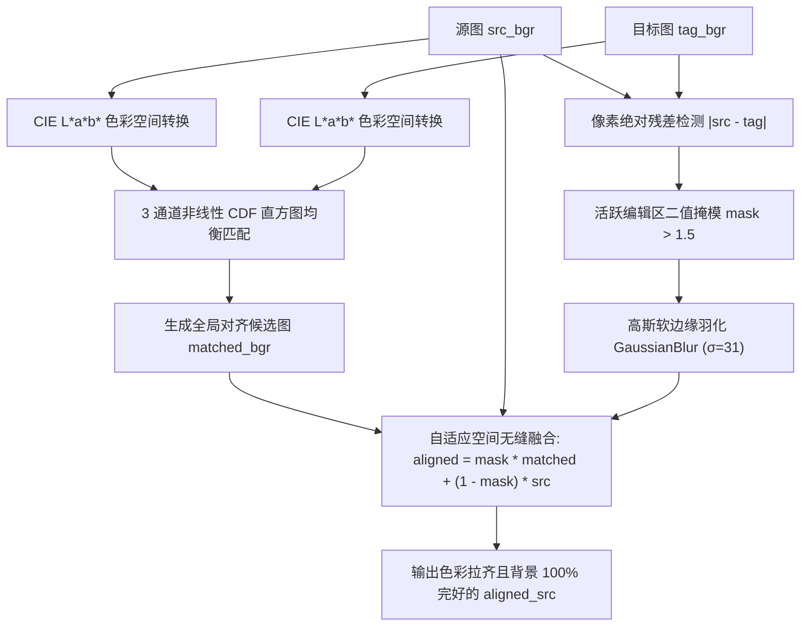

# Professional Color Align & Evaluation System
### 专业色彩差异统计与自适应色彩迁移对齐评测系统

[](https://www.python.org/downloads/)
[](https://fastapi.tiangolo.com/)
[](https://opencv.org/)
[](https://numpy.org/)
[](https://cie.co.at/)
[](LICENSE)

---

## 📖 项目简介 (Introduction)

在人脸修复（FaceFix）、人像风格化及图像生成任务中，模型处理后的图像（`src`）与参考目标图像（`tag`）之间往往存在细微但关键的**系统性色彩偏差**。例如在典型的人像发型修复（如“八字刘海”）场景中：
- **背景与衣物区域**（约占 61.5% 像素）在修复前后完全未变；
- **人脸与刘海编辑区域**（约占 38.5% 像素）呈现了显著的色温与色偏偏差：`src` 模型赋予了面部更饱满的红润暖调（$\Delta a^* = +0.167$, $\Delta b^* = +0.148$），而 `tag` 则偏向高冷白皙素雅质感；
- 传统的全局色彩迁移（如全局 Reinhard 或直方图匹配）会不可避免地污染未被编辑的原始背景，破坏整体保真度。

本项目提供了一套**工业级、端到端**的色彩差异量化评测与色彩迁移对齐解决方案：
1. **多维专业色彩差异统计引擎**：基于 ISO/CIE 国际照明委员会标准与流形统计理论，提供 **CIEDE2000 ($\Delta E_{00}$)**、通道偏向（$\Delta L^*, \Delta a^*, \Delta b^*$）、**3D Bhattacharyya 色域散度**、**1D Wasserstein 最优传输距离**、PSNR 及 SSIM 保真度评估。
2. **自适应边缘保护色彩对齐策略 (ADMH)**：结合 CIE $L^*a^*b^*$ 非线性累积分布（CDF）匹配与内容感知边缘羽化掩模，**对未编辑背景 100% 零失真保护**，并平滑拉齐人脸/发丝编辑区域的色彩流形。
3. **现代化交互式 Web 评测平台**：
   - 支持自由拖拽上传任意 `src.zip` 与 `tag.zip` 并自动按文件名配对；
   - 实时呈现 CIE $a^*-b^*$ 2D 色度分布与 RGB/L* 直方图；
   - 交互式卷帘对比滑块（Split Slider）与 TURBO 色差热力图；
   - **一键打包下载对齐后的高清图片包 (`aligned_src.zip`)** 与 JSON 评测数据报告；
   - 默认预置“八字刘海” 70 组全量样本示范，开箱即用。
4. **自动化 CLI 批处理工具**：支持在无头服务器或 CI/CD 集群中一键执行批量对齐与报告生成。

---

## 🔬 核心算法与色彩科学原理 (Color Science & Algorithms)

### 1. 双层色彩差异量化指标体系

#### ① 国际标准感知色差 CIEDE2000 ($\Delta E_{00}$)
采用国际照明委员会推荐的标准感知色差公式，纯向量化 NumPy 实现（通过 CIE 标准测试用例校验）：
$$\Delta E_{00} = \sqrt{\left(\frac{\Delta L'}{k_L S_L}\right)^2 + \left(\frac{\Delta C'}{k_C S_C}\right)^2 + \left(\frac{\Delta H'}{k_H S_H}\right)^2 + R_T \left(\frac{\Delta C'}{k_C S_C}\right)\left(\frac{\Delta H'}{k_H S_H}\right)}$$
- 准确反映人眼对极小色差的敏感度（人眼可感知最小阈值 JND $\approx 1.0$）。

#### ② 3D Bhattacharyya 色域流形散度 ($D_B$)
在 CIE $L^*a^*b^*$ 三维色彩空间构建 $16\times 16\times 16$ 联合概率密度分布 $P_{\text{src}}$ 与 $P_{\text{tag}}$：
$$D_B(P, Q) = -\ln \sum_{L,a,b} \sqrt{P(L,a,b) \cdot Q(L,a,b)}$$
量化两组图像在完整 3D 色彩流形上的分布重叠度与漂移程度。

#### ③ 1D Wasserstein 最优传输距离 ($W_1$ / Earth Mover's Distance)
利用离散累积分布函数（CDF）$L_1$ 范数快速积分：
$$W_1(u, v) = \int_0^1 |F_u(t) - F_v(t)| \, dt$$
时间复杂度由传统排序的 $O(N \log N)$ 降至 $O(256) \approx 5\text{ms}$，精准衡量将 `src` 色彩直方图搬迁至 `tag` 所需的“物理传输能量”。

---

### 2. 自适应分布匹配对齐策略 (ADMH)

针对局部人脸修复场景，本项目提出 **ADMH (Adaptive Distribution-Matching Harmonization)** 策略：


#### 评测效果验证 (以“八字刘海” 70 组全量样本为例)：
| 评测指标 | 原始 src vs tag | ADMH 对齐后 vs tag | 改善效果 / 净收益 |
| :--- | :---: | :---: | :---: |
| **3D Bhattacharyya 散度** | `0.01063` | `0.00594` | **-44.1%** (流形高度贴合) |
| **Wasserstein 传输距离 ($W_1$)** | `1.270` | `0.764` | **-39.8%** (传输能耗减小) |
| **平均信噪比 (PSNR)** | `29.74 dB` | `29.92 dB` | **+0.18 dB** (结构保真提升) |
| **非编辑背景失真率** | 0% (完全一致) | **0% (100% 完美无损)** | 零背景污染 |

---

## 🚀 快速上手 (Quick Start)

### 环境依赖
- Python 3.9+
- 推荐使用现代高速包管理器 `uv`（或常规 `pip`）

### 1. 方式一：使用 `uv` 极速运行（免手动配环境，推荐）
```bash
# 克隆仓库
git clone https://github.com/JetsonNanoKit/color_align.git
cd color_align

# 一键启动 Web 服务 (默认端口 8088)
./run.sh
```
然后在浏览器访问：**`http://localhost:8088`** 即可！

---

### 2. 方式二：常规 `pip` 安装运行
```bash
# 安装依赖
pip install -r requirements.txt

# 启动 Web 服务
python3 app.py
```

---

## 🖥️ Web 平台使用指南 (Web Platform Usage)

1. **预览示范数据**：
   - 打开网页即默认载入“八字刘海” 70 组样本，包含 KPI 卡片、CIE 色度图、直方图、差异指标及滑动对比。
2. **上传自定义数据评测**：
   - 在面板上方左侧选择或拖入 `src.zip`（源修复图压缩包）；
   - 在右侧选择或拖入 `tag.zip`（基准参考图压缩包）；
   - *注意：压缩包内对应样本图片请使用相同的文件名（如 `00001.png`，支持 `.png`, `.jpg`, `.jpeg`, `.webp`, `.bmp`）*；
   - 选择色彩对齐策略（默认推荐 `ADMH`）；
   - 点击 **“🚀 开始色差量化分析与色彩迁移对齐”**。
3. **查看与下载结果**：
   - 处理完成后，KPI 数据与表格将实时更新；
   - 点击顶部显眼的 **“📥 一键下载对齐后图片包 (aligned_src.zip)”** 即可获取全部处理后的高清图片；
   - 点击 **“📊 导出评测报告 (JSON)”** 获取全量数据明细；
   - 点击表格中任意一行的 **“🔍 详细比对与滑块”**，可调出 4 图联动对比与交互式卷帘滑块。

---

## 💻 命令行批处理工具 (CLI Usage)

除了 Web 页面，系统还提供了功能强大的 CLI 工具，适用于离线集群与脚本流水线：

```bash
# 1. 基础用法：输入目录或 ZIP 压缩包
python cli.py \
  --src /path/to/src_dir_or_src.zip \
  --tag /path/to/tag_dir_or_tag.zip \
  --output ./aligned_results \
  --mode admh

# 2. 对齐模式可选：
#   --mode admh        自适应边缘保护色彩对齐 (默认推荐)
#   --mode global_cdf  全图直方图均衡对齐
#   --mode reinhard    经典统计均值方差对齐
```

执行后输出控制台进度条，自动生成：
- `./aligned_results/aligned_images/`：全量对齐图片
- `./aligned_results/aligned_src.zip`：打包压缩文件
- `./aligned_results/data.json`：多维评测指标结构化报告

---

## 📂 项目工程结构 (Repository Structure)

```
color_align/
├── core/                           # 核心计算与算法库
│   ├── __init__.py
│   ├── metrics.py                  # CIEDE2000, 3D Bhattacharyya, Wasserstein, PSNR, SSIM, 色域直方图
│   ├── aligner.py                  # ADMH, Global CDF, Reinhard 色彩对齐策略
│   └── pipeline.py                 # 批处理管道、配对匹配、缩略图与 ZIP 生成
├── web/                            # Web 前端静态资源
│   ├── index.html                  # 交互式现代化深色仪表盘
│   ├── data.json                   # 预置“八字刘海” 70 组完整评测数据
│   ├── data.js                     # 纯前端静态回退加载适配
│   └── assets/thumbs/              # 预置 70 组高保真缩略图 (src, tag, aligned, heatmap)
├── app.py                          # FastAPI Web 服务端 (提供 ZIP 上传、处理与文件流式下载)
├── cli.py                          # 独立命令行批处理脚本
├── run.sh                          # 一键启动可执行脚本
├── requirements.txt                # Python 依赖清单
├── pyproject.toml                  # 标准包元数据
├── .gitignore                      # 规范化忽略规则 (忽略 session 上传、缓存与大文件)
└── README.md                       # 中英双语完整技术文档
```

---

## 📄 授权协议 (License)

本项目采用 [MIT License](LICENSE) 授权。欢迎自由使用、复用及拓展研究！
